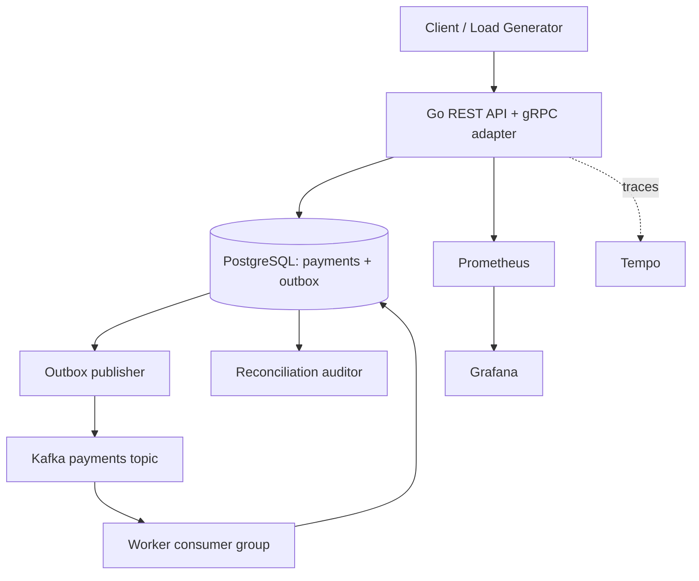

# Nexora — Distributed Payment Processing & Reliability Platform

**Go · gRPC · Kafka · PostgreSQL · Docker · Kubernetes · Prometheus · Grafana · OpenTelemetry**

> **Engineering status:** The core deterministic Go engine and its tests run locally. The distributed services, container stack, gRPC endpoint, and dashboards are included as source/configuration but have **not** been verified end-to-end in this environment. Do not treat this repository as production-ready or use it for real money.

Nexora is an educational distributed transaction platform focused on **durability, at-least-once event delivery, idempotent financial effects, and failure recovery**. The repository has two Go modules: a dependency-free core simulator at the root and a PostgreSQL/Kafka-backed distributed extension in `distributed/`.

## Architecture



### Guarantees and limitations

- Payment creation and outbox event insertion happen in **one PostgreSQL transaction**.
- The publisher can produce an event more than once after a crash; Kafka delivery is **at least once**, not exactly once.
- The worker uses a transactional inbox plus unique ledger keys to prevent duplicate financial postings on replay.
- A settled payment should have a zero-sum pair of ledger postings. The auditor reports violations.
- The demo has **no real payment provider, settlement rails, PCI compliance, production auth, or multi-region replication**.
- gRPC currently accepts `google.protobuf.Struct` messages; `distributed/proto/payment.proto` is a typed-schema migration target, not generated server code.
- The core simulator and distributed extension are separate demonstrations; they do not share a single runtime state store.

## NEW: Runnable payment lifecycle reference model (no Docker)

A concurrency-safe reference implementation of **authorization, capture, void, partial/full refunds, merchant-scoped idempotency and balanced double-entry postings** is included at `internal/payments/`. It is deliberately **in-memory** and separate from the PostgreSQL/Kafka extension; it is not a production payment service.

```bash
go test -race ./...
go run ./cmd/nexora-demo
# In another terminal:
bash scripts/demo.sh
```

See [engineering status](docs/ENGINEERING-STATUS.md) for a verified-versus-planned feature matrix and release acceptance criteria.

## Quick start — core (no Docker)

Requirements: Go 1.23+.

```bash
go test -race ./...
go vet ./...
go run ./cmd/faultlab --help
```

## Quick start — distributed extension (Docker required)

```bash
cd distributed
docker compose up --build -d
docker compose ps
bash scripts/smoke.sh
```

Services (if startup succeeds): REST `http://localhost:8081`, gRPC `localhost:9090`, Prometheus `http://localhost:9091`, Grafana `http://localhost:3000`.

Create a payment:

```bash
curl -i -X POST http://localhost:8081/payments \
  -H 'Content-Type: application/json' \
  -H 'Idempotency-Key: example-payment-001' \
  -d '{"amount_cents":1250}'
```

Repeat with the same key and amount to retrieve the same payment; a different amount must be rejected. Poll `GET /payments/{id}` for status. See `distributed/README.md` for design details.

## Repository guide

| Path | Purpose |
|---|---|
| `cmd/`, `internal/engine/`, `internal/primitives/` | Deterministic simulator, concurrency primitives, verification CLI |
| `internal/webhooks/` | Tested HMAC webhook signature building block (not yet a delivery service) |
| `internal/reliability/` | Tested bounded retry backoff building block |
| `distributed/cmd/api/` | REST and gRPC API |
| `distributed/cmd/publisher/` | Transactional outbox to Kafka |
| `distributed/cmd/worker/` | Kafka consumer and idempotent ledger posting |
| `distributed/cmd/reconciler/` | Ledger audit |
| `distributed/sql/` | PostgreSQL schema |
| `distributed/observability/` | Prometheus, Grafana and Tempo configs |
| `distributed/k8s/` | Kubernetes example manifests |
| `benchmarks/` | k6 starter workload; results not yet measured |
| `docs/` | Experiment notes, threat model and design decisions |

## Engineering roadmap (NOT implemented yet)

- Real typed Protobuf-generated gRPC clients/server, deadlines and authentication
- Provider simulator, authorization/capture/refund lifecycle, webhook delivery worker
- Multi-tenant isolation, JWT/mTLS, RBAC, audited secrets management
- Kafka DLQ and replay tooling, bounded retry budgets, backpressure
- KEDA/HPA, resilient multi-node coordination with fencing, disaster-recovery drills
- Deterministic chaos controller, property-based invariants and integration CI
- Reproducible scale benchmarks, verified p95/p99 and recovery measurements

These are deliberately labeled **planned**, rather than claimed as working features. A strong engineering portfolio should be honest about guarantees and measured results.

## Development

Run `go test -race ./...` at the repository root. The distributed extension is a **separate Go module**; use `cd distributed && go test ./...` to test it after fetching its dependencies. CI includes separate jobs for both modules.

## License

MIT — see `LICENSE`.


## Local deterministic chaos experiment

```bash
go run ./cmd/nexora-chaos
go test -race ./...
```

The experiment races 100 identical capture requests against the in-memory reference model, then checks that exactly one double-entry posting was created. **It is not a Kafka or database failure test.**

See [implementation gaps](docs/IMPLEMENTATION-GAPS.md) before describing Nexora as complete.


## Large-scale engineering additions

This edition includes scalable outbox claims (`SKIP LOCKED`), retry leases, a persistent Kafka producer, partition-affinity by payment ID, durable poison-message quarantine, and a tested bounded-admission primitive. See [Scaling design and limitations](docs/SCALING.md). These changes are source-level additions, **not evidence of a production-scale benchmark**.
