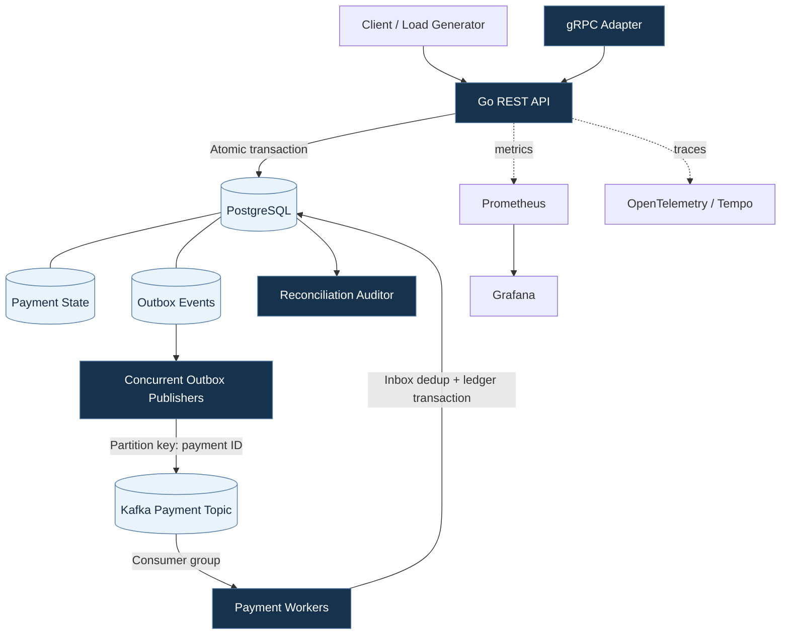
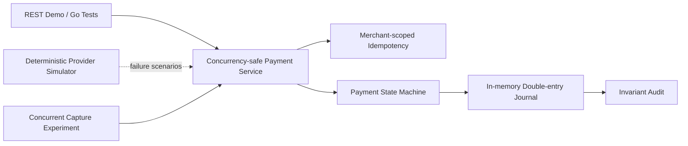
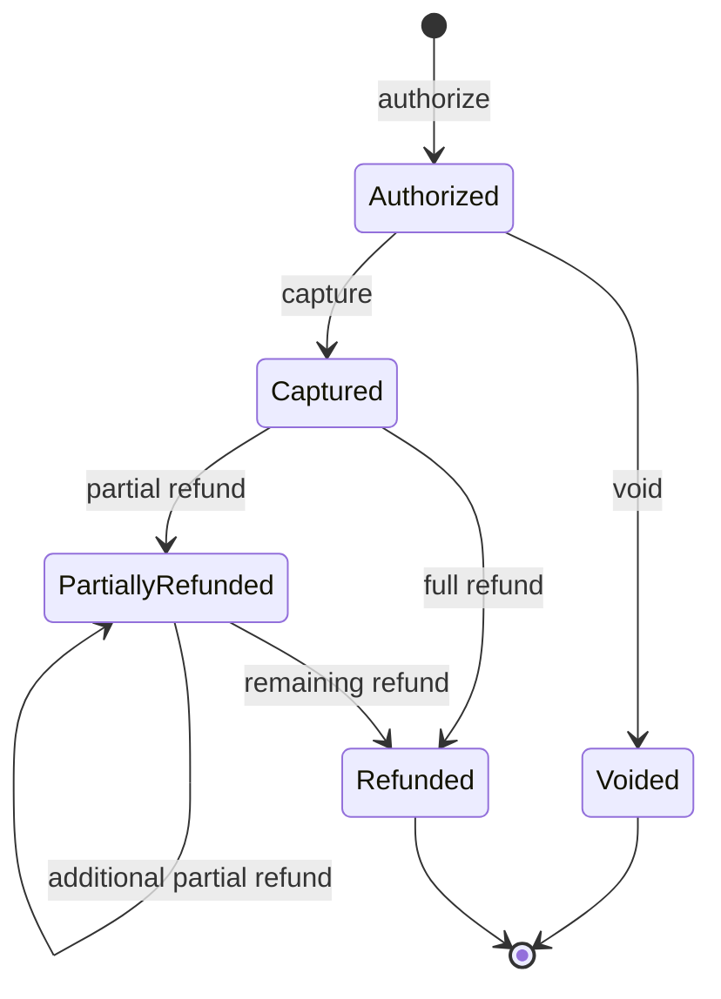
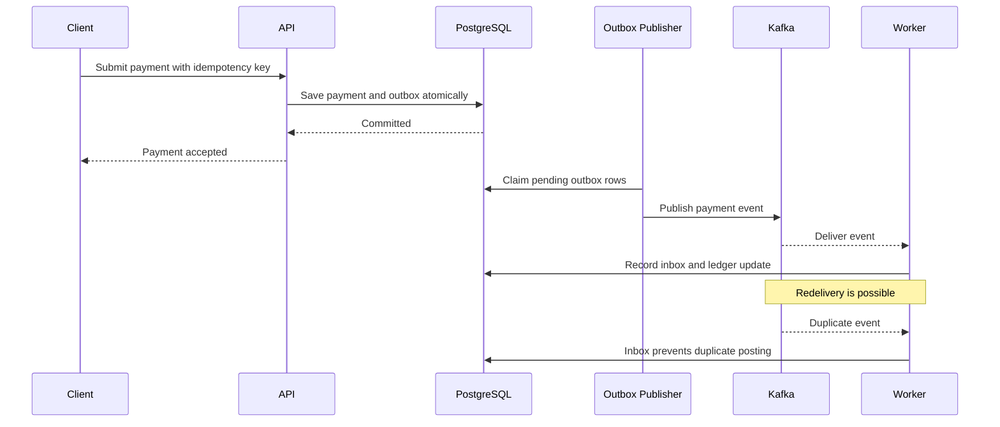

<div align="center">

# NEXORA
### Distributed Payment Processing & Reliability Engineering

**Designing reliable financial workflows across asynchronous, failure-prone services.**

**Go · gRPC · Apache Kafka · PostgreSQL · Docker · Kubernetes · Prometheus · Grafana · OpenTelemetry**

[Architecture](#architecture) · [Payment Lifecycle](#payment-lifecycle) · [Reliability](#reliability--correctness) · [Getting Started](#getting-started) · [Roadmap](#engineering-roadmap)

</div>

---

## Why Nexora?

Distributed payment systems have an unusually strict requirement: **a retry must never become a second financial effect**. Network timeouts, process crashes, duplicate messages, and asynchronous delivery make that difficult.

Nexora is a hands-on distributed-systems engineering project built to explore those problems using **Go, PostgreSQL, Kafka, concurrency-safe state machines, and fault-injection experiments**.

The repository currently contains two complementary implementations:

- **Payment lifecycle reference engine** — a tested, in-memory Go model for authorization, capture, void, partial/full refunds, merchant-scoped idempotency, and balanced ledger postings.
- **Distributed processing extension** — Go REST/gRPC adapter, PostgreSQL transaction/outbox/inbox code, Kafka publisher and worker, reconciliation auditor, and observability/deployment configurations. This extension requires end-to-end integration validation.

> **Engineering scope:** This is an educational system, not a real-money payment processor. The reference engine and distributed extension are not yet one unified durable payment lifecycle. No production throughput, availability, or compliance claims are made.

## Architecture

### 1. Distributed event-processing design



**Architecture note:** The diagram describes the distributed extension's intended processing path. It is not a claim that every component has been validated together under Docker or Kubernetes.

### 2. Local payment reference engine



This reference engine is intentionally **in memory**. Its state is not durable across process restarts.

## Payment Lifecycle



The local reference engine supports authorization, capture, void, and partial/full refunds. It validates idempotency within a merchant scope and produces balanced accounting entries for financial effects.

## Reliability & Correctness

### Transactional outbox

A database transaction writes payment state and an outbox event together. An asynchronous publisher claims outbox rows and publishes them to Kafka. The code includes **`SKIP LOCKED` row claiming, expiring claims, retry scheduling, and Kafka producer reuse**.

### At-least-once delivery, idempotent effects

A publisher may crash after Kafka accepts an event but before the database marks that event as published. This can produce duplicates. Nexora's distributed design uses an **inbox record and ledger uniqueness constraints** to make replay safe; this still requires end-to-end failure testing.



### Failure scenarios

| Failure window | Intended recovery behavior |
|---|---|
| API crashes before database commit | No partial payment/outbox transaction |
| API crashes after commit | Retried request resolves using idempotency key |
| Publisher crashes after Kafka acknowledgement | Event may be republished; consumer deduplicates |
| Worker crashes before database commit | Event can be redelivered |
| Worker crashes after database commit, before Kafka offset commit | Transactional inbox prevents a second ledger effect |
| Malformed event | Durable quarantine path in the distributed code |

**Core invariants:** Idempotency-key conflicts are rejected; financial postings balance; a replay must not cause a second posting. The local engine's invariants have automated tests; distributed guarantees remain subject to integration verification.

## Engineering Highlights

| Focus | Implementation / evidence |
|---|---|
| Go concurrency | Payment-state synchronization, bounded-concurrency primitive, race-detector tests |
| Financial correctness | Double-entry reference ledger and balance audit |
| Failure simulation | Deterministic provider delay/outage behavior and concurrent duplicate-capture experiment |
| Asynchronous messaging | Kafka producer/worker source and payment-ID partition affinity |
| Database reliability | PostgreSQL transactional outbox/inbox code and ledger constraints |
| Outbox scaling | `SKIP LOCKED` claiming, claim expiry, retry scheduling |
| Service communication | REST API and generic-Struct gRPC adapter; typed Protobuf generation is not yet integrated |
| Observability | Prometheus/Grafana/Tempo configuration and tracing source |
| Deployment | Docker Compose and Kubernetes example manifests |
| Engineering evidence | Go tests, race detector, `go vet`, documentation, and k6 workload starter |

## Technology Stack

| Layer | Technology |
|---|---|
| Core implementation | Go |
| Interfaces | REST, gRPC adapter |
| Event streaming | Apache Kafka |
| Persistence | PostgreSQL |
| Reliability patterns | Transactional outbox/inbox, idempotency, retries, backpressure primitives |
| Telemetry | Prometheus, Grafana, OpenTelemetry, Tempo |
| Packaging | Docker Compose, Kubernetes examples |
| Tests and tooling | Go test/race detector, GitHub Actions, k6 starter |

## Getting Started

### Prerequisites

- Go 1.23+
- Docker Desktop for the distributed extension
- Git

### Clone and test the core

```bash
git clone https://github.com/saiteja0367/nexora-payment-platform.git
cd nexora-payment-platform
go test -race ./...
go vet ./...
```

### Run the local payment lifecycle demo

```bash
go run ./cmd/nexora-demo
```

In a separate terminal:

```bash
bash scripts/demo.sh
```

### Run the concurrency experiment

```bash
go run ./cmd/nexora-chaos
```

This exercises concurrent duplicate-capture attempts against the **local in-memory engine** and checks ledger balance. It is not a multi-node chaos benchmark.

### Start the distributed extension

```bash
cd distributed
docker compose up --build -d
docker compose ps
bash scripts/smoke.sh
```

Configured endpoints, **if the stack starts successfully**:

| Interface | Address |
|---|---|
| REST API | `http://localhost:8081` |
| gRPC adapter | `localhost:9090` |
| Prometheus | `http://localhost:9091` |
| Grafana | `http://localhost:3000` |

The distributed stack has not yet been independently verified end to end. See [`docs/ENGINEERING-STATUS.md`](docs/ENGINEERING-STATUS.md) for precise status and acceptance criteria.

## Repository Layout

```text
nexora-payment-platform/
├── cmd/
│   ├── nexora-demo/           # Local payment lifecycle API
│   ├── nexora-chaos/          # Concurrent capture experiment
│   ├── faultlab/              # Original simulation CLI
│   └── faultlab-check/        # Verification CLI
├── internal/
│   ├── payments/              # Payment state machine and journal
│   ├── provider/              # Deterministic failure simulator
│   ├── engine/                # Core simulation engine
│   ├── primitives/            # Concurrency primitives
│   ├── overload/              # Bounded-concurrency gate
│   ├── reliability/           # Backoff utilities
│   └── webhooks/              # HMAC signing utility
├── distributed/
│   ├── cmd/                   # API, publisher, worker, reconciler
│   ├── internal/              # Storage, messaging, RPC, tracing
│   ├── sql/                   # Database schema
│   ├── proto/                 # Payment schema
│   ├── observability/         # Metrics, dashboards, tracing config
│   ├── k8s/                   # Example Kubernetes manifests
│   └── compose.yaml
├── benchmarks/                # k6 starter workload
├── docs/                      # Architecture, experiments, ADRs
├── scripts/                   # Demo and verification scripts
├── .github/workflows/         # CI configuration
├── FEATURE_ROADMAP.md
├── go.mod
└── README.md
```

## Engineering Roadmap

Nexora's longer-term design includes durable authorization/capture/refund workflows, typed Protobuf services, provider routing and failover, durable signed webhooks, saga orchestration, Kafka DLQ/replay, merchant isolation, JWT/mTLS, KEDA-based scaling, chaos experiments, disaster recovery, and measured performance benchmarks.

These are **development goals**, not claims of implemented production functionality. See [`FEATURE_ROADMAP.md`](FEATURE_ROADMAP.md) and [`docs/IMPLEMENTATION-GAPS.md`](docs/IMPLEMENTATION-GAPS.md).


## Design Principles

**Correctness before throughput.** **Assume at-least-once delivery.** **Make failures observable.** **Test concurrency explicitly.** **Publish measurements only when reproducible.**

---

<div align="center">

**Nexora — Reliable transactions are designed, tested, and proven.**

</div>
